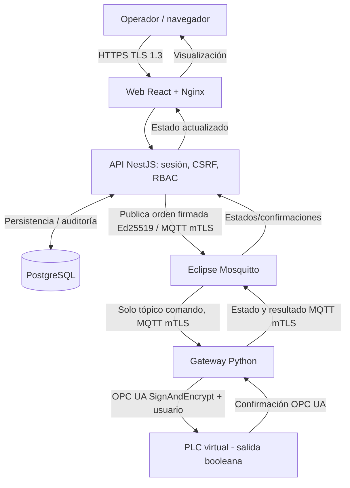

# OT Bridge — prototipo de control PLC mediante MQTT seguro

**Versión:** 1.0 · **Idioma:** español · **Ámbito:** laboratorio académico **simulado**.

Prototipo de una aplicación web con autenticación y controles de acceso que solicita encender o apagar una **salida digital virtual** de un PLC simulado, comunicándose mediante **Eclipse Mosquitto (MQTT 5 + TLS 1.3 + mTLS)**, un gateway Python y **OPC UA SignAndEncrypt**. Los mensajes de control están firmados con **Ed25519**. Un panel web permite observar el estado en modo SCADA de solo lectura y revisar la auditoría en PostgreSQL.

**ATENCIÓN:** no se ha realizado una validación de seguridad industrial de esta solución, ni debe conectarse a equipos reales o instalaciones operativas. Se requieren análisis de seguridad funcional, enclavamientos, pruebas de aceptación y controles de ingeniería adicionales antes de considerar hardware físico. La salida simulada NO es el interruptor de alimentación del PLC.

## Arquitectura



### Capas

| Segmento | Controles aplicados |
|---|---|
| Navegador ↔ Nginx | TLS 1.3 con certificado CA de pruebas; cookie `HttpOnly; Secure; SameSite=Strict` |
| API | Contraseñas bcrypt, sesiones aleatorias persistentes, CSRF, RBAC, límite de intentos de login, validación de solicitudes |
| Backend ↔ Mosquitto ↔ Gateway | TLS 1.3, mTLS X.509, ACL por identidad CN, MQTT QoS 1, sin mensajes retained |
| Comando | Firma Ed25519, `commandId`, vencimiento a los 15 segundos, estado `PENDING`/`APPLIED`/`REJECTED` |
| Gateway ↔ PLC virtual | OPC UA `Basic256Sha256_SignAndEncrypt`, certificados de aplicación en lista de confianza, usuario específico |
| Gateway | Validación de firma, tiempo, tipo de acción, dispositivo y duplicados en SQLite persistente |
| Supervisión | Dashboard de solo lectura; perfil opcional FUXA no preconfigurado |

**Criptografía:** TLS 1.3 usa suites modernas negociadas entre los pares; la configuración **no fija** AES-256-GCM porque la suite real depende del resultado de la negociación. La prueba `security_smoke.py` muestra la suite seleccionada. El modo OPC UA `Basic256Sha256` es distinto de la suite TLS y utiliza la criptografía definida por dicha política. Ed25519 se aplica al **comando**, no al tráfico completo.

## 1. Requisitos

- Windows 10/11 con **Docker Desktop** y Compose v2, o Linux con Docker Engine + Compose.
- 4 GB de RAM libres aproximadamente; puertos locales **8443** y **1881** (opcional).
- Acceso a Internet durante la primera construcción para descargar imágenes y dependencias npm/pip.
- **No necesitas instalar** React, Node.js ni Python en el host si utilizas Docker.

## 2. Preparación en Windows (PowerShell)

Descomprime el ZIP. En PowerShell, sitúate en la carpeta del proyecto:

```powershell
cd .\puente_ot_scada_mosquitto
Copy-Item .env.example .env
```

**Genera** contraseñas, CA privada, certificados con SAN y claves de firma:

```powershell
docker compose --profile setup run --build --rm certgen
```

Si termina con `Inicialización completa`, abre el archivo `.env` en VS Code para consultar las contraseñas generadas (NO compartas el archivo y NO subas certificados privados a GitHub).

Inicia los servicios:

```powershell
docker compose up -d --build
```

Comprueba el estado de los servicios:

```powershell
docker compose ps
docker compose logs --tail=50 gateway api plc mosquitto
```

En tu navegador abre **https://localhost:8443**. El certificado del servidor es de una CA local generada por el prototipo, por lo que tu navegador inicialmente mostrará un aviso de confianza. Acepta la excepción solo en este entorno de laboratorio aislado o importa la CA del laboratorio siguiendo la política de tu equipo. **Nunca** desactives la verificación TLS en el código.

**Credenciales:** consulta `ADMIN_EMAIL` / `ADMIN_PASSWORD` en `.env`. El usuario de observación utiliza `VIEWER_EMAIL` / `VIEWER_PASSWORD` y **no puede** activar la salida.

> Si la app no muestra telemetría al inicio, revisa los logs de `plc`, `gateway` y `mosquitto`. El gateway espera a que el servidor OPC UA esté disponible y reintenta automáticamente.

### 3. Demostración funcional

1. Inicia sesión como `operador@laboratorio.local` con la contraseña de `.env`.
2. Comprueba que PLC-01 figura **ONLINE** y que MQTT está **CONECTADO**. El valor inicial de salida es **APAGADA**.
3. Pulsa **ENCENDER** y confirma. La API devuelve `PENDING` (publicado), no supone que la acción ya ocurrió.
4. Tras la respuesta del gateway OPC UA, verás la salida **ENCENDIDA** y un comando con resultado **APPLIED** en «Auditoría».
5. Pulsa **APAGAR** y comprueba la misma secuencia.
6. Entra con la cuenta `viewer`: podrá ver SCADA y auditoría pero **no** cambiar la salida.

### 4. Pruebas de seguridad

**TLS 1.3 con mTLS:**

```powershell
docker compose --profile test run --rm tester
docker compose --profile test run --build --rm gateway-tester
```

El test intenta establecer TLS con un certificado válido y luego comprueba que un cliente sin certificado no puede usar MQTT. En Wireshark puedes capturar el tráfico entre los contenedores usando la interfaz Docker correspondiente: el contenido del MQTT cifrado no será legible como mensaje MQTT en texto plano.

**Observación de logs:**

```powershell
docker compose logs -f gateway mosquitto api
```

**Prueba de control de acceso:** inicia sesión como `viewer` e intenta operar; el botón estará deshabilitado y la API devolverá `403` si se fuerza la solicitud.

**Prueba de sesión:** sin cookie válida la API responde `401`. Si existe sesión pero no se envía `X-CSRF-Token` válido para `POST /api/plc/command`, responde `403`.

**Repetición de mensajes:** el gateway registra cada `commandId` ejecutado en `/data/replay.sqlite`, montado en el volumen `gateway_data`. El mismo comando vuelve a ser rechazado. La pérdida de conexión no genera nuevas ejecuciones de órdenes retenidas, porque los comandos no son retained y el cliente MQTT utiliza sesión limpia.

**Restricciones adicionales:** un comando expirado, con firma corrupta, dispositivo diferente o acción no incluida en `ON/OFF` es rechazado. La defensa no se basa exclusivamente en la ACL del broker.

### 5. SCADA — dos opciones

- **Integrado y funcional:** en la web, apartado «Supervisión SCADA», se muestra un panel HMI de solo lectura con PLC-01, estado de la salida y estado del transporte. Se alimenta de los datos confirmados por el gateway y almacenados por NestJS.
- **FUXA opcional:** el perfil `scada` agrega FUXA localmente con `docker compose --profile scada up -d` y abre **http://localhost:1881**. **FUXA se instala pero NO queda conectado de forma automática a los datos.** Para vincularlo habría que desarrollar o configurar un conector de solo lectura, de acuerdo con la versión elegida y su modelo de autenticación. La imagen incluida está etiquetada `latest`; antes de hacer un despliegue prolongado fíjala a una versión probada. **Nunca** configures FUXA con credenciales del gateway capaces de escribir al PLC en un sistema real.

### 6. Estructura del repositorio

```text
puente_ot_scada_mosquitto/
├── compose.yaml                # Segregación de redes y servicios
├── .env.example                # Variables de ejemplo
├── scripts/
│   ├── bootstrap.py            # CA, TLS, OPC UA, clave Ed25519, contraseñas
│   └── Dockerfile.certgen
├── certs/                      # Generados; excluidos del ZIP y de Git
├── broker/
│   ├── mosquitto.conf          # Solo 8883, TLS 1.3, mTLS
│   └── acl                     # ACL mínima por identidad de certificado
├── api/                        # NestJS + PostgreSQL + MQTT
├── web/                        # React/Vite + Nginx HTTPS
├── ot/
│   ├── plc.py                  # PLC OPC UA virtual
│   └── gateway.py              # Firma, replay, MQTT y OPC UA
└── tests/                      # Pruebas TLS y certificados
```

### 7. Puertos y redes

| Puerto | Publicado al host | Uso |
|---|---|---|
| `8443` | Solo `127.0.0.1` | Nginx HTTPS y web |
| `1881` | Solo `127.0.0.1`, opcional | FUXA, instalación no configurada |
| `8883` | **No** | Mosquitto mTLS en red Docker |
| `4840` | **No** | PLC OPC UA en red Docker OT |
| `5432` | **No** | PostgreSQL en red IT |

Las redes `ot`, `message`, `it` de Compose son **internas**. El gateway puede acceder al broker y al PLC; el backend al broker y la base de datos; la web solamente expone el HTTPS del laboratorio.

### 8. Conexión futura de un PLC físico

El cambio se realiza **en el gateway**, no en la web ni en Mosquitto. Se debe reemplazar la URL y el nodo OPC UA en `ot/gateway.py`, configurar certificados y permisos en el PLC real y proporcionar un entorno de pruebas aislado. **No conectar directamente un PLC industrial a Internet ni permitir que el backend le envíe órdenes sin el gateway.** Para un S7-1200, comprobar soporte OPC UA, licencias, firmware, permisos de escritura, políticas criptográficas y procedimientos del fabricante. Añadir reglas operacionales independientes de la autorización informática (enclavamientos, estado seguro ante desconexión, botón de parada local, límites de proceso). No utilizar la demo para energizar o desenergizar cargas peligrosas.

### 9. Limitaciones conocidas y siguientes pasos

- Prototipo académico sin pruebas integrales en un runtime Docker de producción ni pruebas con PLC físico. Ejecuta el checklist y ajusta lo necesario según las versiones descargadas.
- La web funciona con CA de laboratorio; en un entorno real requiere certificado emitido por PKI administrada y gestión de revocación.
- El panel SCADA interno funciona, pero la integración automática de FUXA sigue pendiente.
- No hay MFA ni federación de identidades en esta versión. Para despliegue institucional añadir MFA/OIDC, control de cambios, registro centralizado, retención y correlación de auditorías.
- No se implementaron enclavamientos de seguridad ni monitoreo de variables de proceso reales; **solo se controla un booleano de simulación**.
- La autenticación de login tiene limitación por IP en memoria; con múltiples réplicas se requiere almacén compartido y umbrales robustos.
- No se implementa gestión automática de revocación de certificados ni rotación sin intervención; hay que definir PKI, CRL/OCSP y procedimiento de actualización. Los certificados del laboratorio caducan a los 120 días; la CA a los 365.
- Las conexiones de la API a PostgreSQL y el salto interno Nginx→API dentro de las redes aisladas no utilizan TLS en este prototipo. Para instalaciones reales usar TLS o endpoints locales con una política de red comprobada.
- El broker es un componente de confianza: firma los comandos la API para que el gateway compruebe su origen independientemente de MQTT, pero el envío de telemetría hacia API se basa en las ACL/mTLS del broker.

### 10. Referencias técnicas

- Eclipse Mosquitto, documentación oficial: https://mosquitto.org/man/mosquitto-conf-5.html
- OASIS, MQTT 5.0: https://docs.oasis-open.org/mqtt/mqtt/v5.0/mqtt-v5.0.html
- OPC UA y seguridad: https://reference.opcfoundation.org/specs/OPC-10000-2/full
- OPC UA Python `asyncua`: https://opcua-asyncio.readthedocs.io/en/latest/
- FUXA, documentación: https://frangoteam.github.io/FUXA/
- NIST SP 800-82 Rev. 3: https://csrc.nist.gov/pubs/sp/800/82/r3/final

## Reinicio y limpieza

Para detener sin borrar datos:

```powershell
docker compose down
```

Para borrar la base de datos y los registros de gateway **en un entorno descartable**:

```powershell
docker compose down -v
```

**No regeneres certificados con volúmenes y sesiones antiguas sin planificar la rotación.** El bootstrap rechaza sobrescribir una CA existente.
